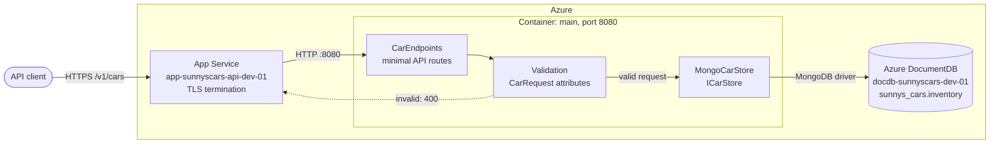
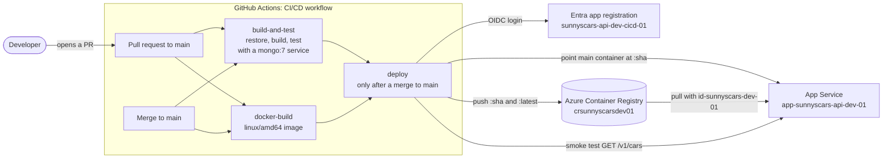

# Sunny's Cars Inventory API

[](https://github.com/sunny-sidhu/sunnyscars-inventory/actions/workflows/ci.yml)

A REST API for the car inventory at Sunny's Cars. You can list, view, add, update and remove the cars on the forecourt. The API is an ASP.NET Core (.NET 10) minimal API that stores cars in MongoDB. It runs in a Docker container on Azure App Service, with Azure DocumentDB (MongoDB compatibility) as its database.

## What it does

All routes are versioned under `/v1`:

| Method | Route | Description | Responses |
|---|---|---|---|
| `GET` | `/v1/cars` | List every car | `200` |
| `GET` | `/v1/cars/{id}` | Get one car | `200`, `404` |
| `POST` | `/v1/cars` | Add a car | `201` with a `Location` header, `400` |
| `PUT` | `/v1/cars/{id}` | Replace a car | `200`, `400`, `404` |
| `DELETE` | `/v1/cars/{id}` | Remove a car | `204`, `404` |

A car looks like this:

```json
{
  "id": "6ae89b7ba121a7e475a6ae01",
  "make": "Toyota",
  "model": "Corolla",
  "colour": "Silver",
  "price": 14995.00,
  "year": 2019,
  "mileage": 42000,
  "transmission": "automatic"
}
```

- `id` is a MongoDB ObjectId, assigned when the car is created. An id that isn't a valid ObjectId returns `404`.
- `POST` and `PUT` take the same fields without `id`. The request is validated before it reaches the database, and a request that breaks any of these rules gets a `400` with a problem-details body:
  - `make` and `model`: 1–50 characters
  - `colour`: 1–30 characters
  - `price`: 0 to 10,000,000
  - `year`: 1886–2100
  - `mileage`: 0 or more
  - `transmission`: `"automatic"` or `"manual"`

## Architecture

### Request flow



- **`CarEndpoints`** (`Endpoints/CarEndpoints.cs`) maps the routes.
- **Validation:** DataAnnotations on `CarRequest` reject bad input with a `400` before the handler runs.
- **`MongoCarStore`** (`Data/MongoCarStore.cs`) reads and writes one document per car through a single shared `MongoClient`, which owns the connection pool.
- **Locally**, the same code talks to a MongoDB server on `localhost:27017`.

### Build and deployment flow



- **Every pull request** runs the tests and builds the container image.
- **After a merge to `main`**, once both CI jobs pass, the `deploy` job:
  1. logs in to Azure with OIDC, so no Azure password is stored in GitHub
  2. pushes the image to ACR
  3. updates the App Service's `main` container to the new commit-SHA tag
  4. smoke-tests the API

The App Service steps are skipped until the `AZURE_WEBAPP_NAME` repository variable is set. The App Service is still being set up (SCI-7).

## Getting started

### Prerequisites

- **.NET 10 SDK**, version 10.0.402 or a later 10.0.4xx patch. `global.json` pins it. Check with `dotnet --version`.
- **MongoDB 7** on `localhost:27017`. The easiest way is Docker:

  ```bash
  docker run -d --name sunnyscars-mongo -p 27017:27017 mongo:7
  ```

  On a Mac without Docker, you can use Homebrew instead: `brew tap mongodb/brew && brew install mongodb-community@7.0 && brew services start mongodb-community@7.0`.
- **mongosh**, to seed the database (`brew install mongosh`, or see the [MongoDB downloads](https://www.mongodb.com/try/download/shell)).
- An editor with `.http` file support (Rider, Visual Studio or VS Code with the REST Client extension), or any HTTP client.

### 1. Clone and build

```bash
git clone https://github.com/sunny-sidhu/sunnyscars-inventory.git
```

```bash
cd sunnyscars-inventory
```

```bash
dotnet build
```

### 2. Seed the local database

```bash
mongosh "mongodb://localhost:27017" scripts/seed-mongodb.js
```

This loads the cars in `SunnysCars.Inventory.Api/Data/cars.json` into `sunnys_cars.inventory`. It only inserts into an empty collection, so it's safe to run again. The API itself never reads `cars.json`.

### 3. Run the API

```bash
dotnet run --project SunnysCars.Inventory.Api
```

The API listens on `http://localhost:5093` in the `Development` environment, which uses the local MongoDB from `appsettings.Development.json`. Try it:

```bash
curl http://localhost:5093/v1/cars
```

- The OpenAPI document is at `http://localhost:5093/openapi/v1.json` (Development only).
- `SunnysCars.Inventory.Api/SunnysCars.Inventory.Api.http` has a sample request for every endpoint. Replace `@carId` with an id from the list response.

> [!WARNING]
> `POST`, `PUT` and `DELETE` change whichever MongoDB the running API points at.

### 4. Run the tests

```bash
dotnet test
```

That runs the unit and endpoint tests, which use an in-memory store and need no database. To also run the `MongoCarStore` tests against your local MongoDB:

```bash
SUNNYSCARS_TEST_MONGO=mongodb://localhost:27017 dotnet test
```

Each of those tests uses its own throwaway `sunnys_cars_test_<guid>` database and drops it afterwards. CI always runs them.

### Optional: build the container image

```bash
docker build --platform linux/amd64 -f SunnysCars.Inventory.Api/Dockerfile -t sunnyscars-inventory-api .
```

- Build from the repo root, because the build needs `global.json`.
- Always target `linux/amd64`, which is what App Service runs, even on an Apple Silicon Mac.
- The container listens on port 8080 and needs a `ConnectionStrings__Mongo` environment variable.

### Optional: run locally against Azure DocumentDB

Put the cluster's global read-write connection string in .NET user secrets. Never put it in `appsettings*.json`.

```bash
dotnet user-secrets set ConnectionStrings:Mongo "<connection string>" --project SunnysCars.Inventory.Api
```

- Keep `retrywrites=false` in the string.
- Your IP address must be allowed in the cluster's Networking firewall.
- To switch back to the local database, run `dotnet user-secrets remove ConnectionStrings:Mongo --project SunnysCars.Inventory.Api`.

## Project layout

```text
SunnysCars.Inventory.slnx              Solution (API + tests)
global.json                            Pinned .NET SDK
SunnysCars.Inventory.Api/
  Program.cs                           Service registration and middleware
  Endpoints/CarEndpoints.cs            /v1/cars routes
  Models/                              Car, CarRequest (validation), Transmission
  Data/                                ICarStore, MongoCarStore, cars.json seed data
  Dockerfile                           Multi-stage linux/amd64 image
  SunnysCars.Inventory.Api.http        Sample requests
SunnysCars.Inventory.Api.Tests/        xUnit tests: endpoints, validation, MongoCarStore
scripts/seed-mongodb.js                Seeds a MongoDB collection from cars.json
.github/workflows/ci.yml               CI/CD: test, build image, deploy to Azure
```

## Contributing

- Branch from `main` and open a pull request. CI must pass before you merge.
- Merging to `main` deploys automatically.
- Work is tracked in Jira under the `SCI` project. Put the ticket key in branch names and commit messages, for example `sci-7-app-service` or `... (SCI-7)`.
- When you add a field to a car, update all of these places:
  - `Car` and `CarRequest`, including `ToCar`
  - the mapping in `MongoCarStore`
  - every entry in `Data/cars.json`
  - the `.http` samples
  - the test fixtures
- [`CLAUDE.md`](CLAUDE.md) has more detail on the architecture, configuration and Azure setup.
